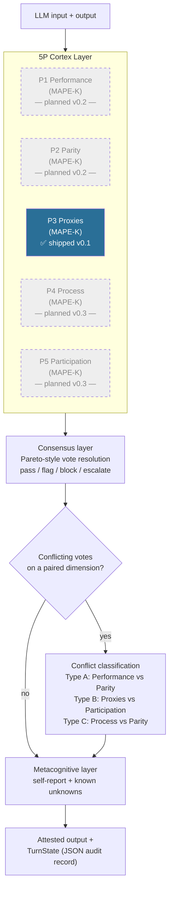
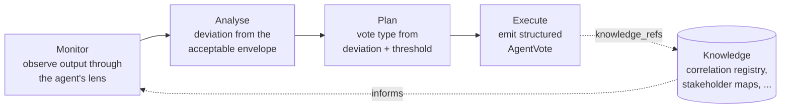
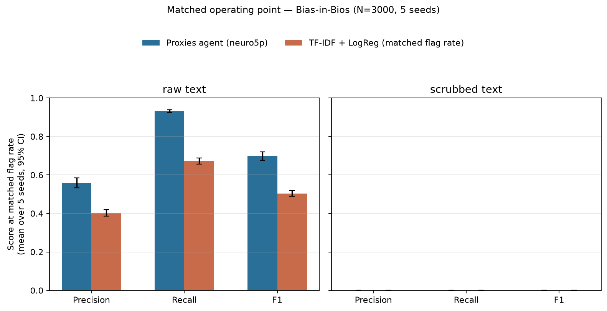
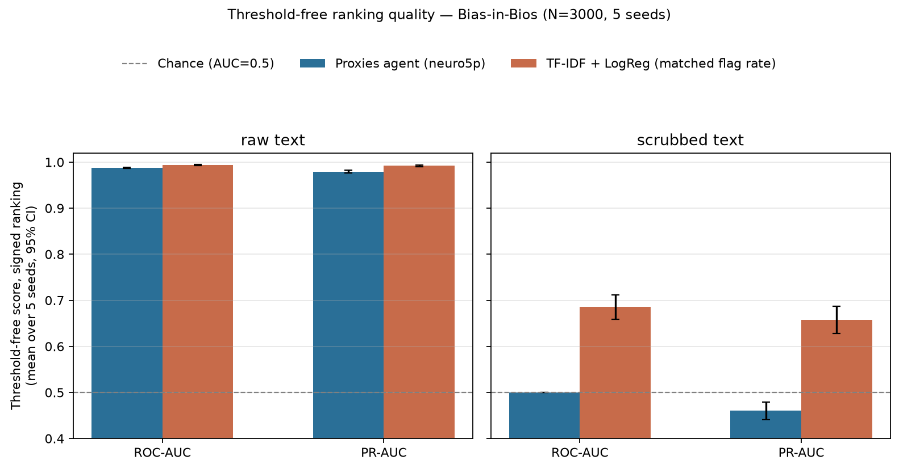
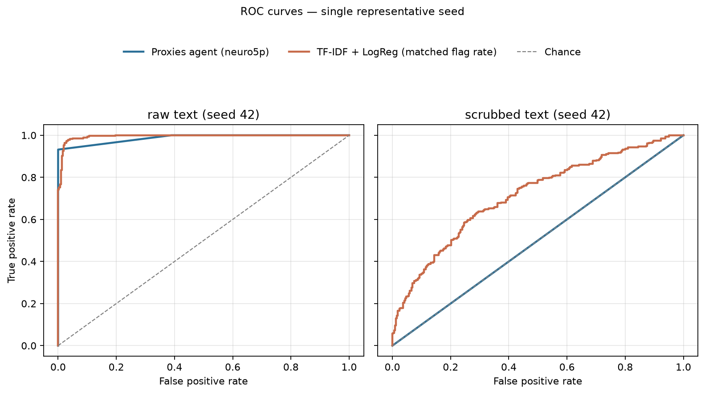

# neuro5p

**Continuous, multi-agent governance middleware for deployed LLMs — v0.1.0.**

[](https://doi.org/10.5281/zenodo.21873506)
[](LICENSE)
[]()

`neuro5p` implements **Neuro-5P**: a continuous governance architecture that attaches
five parallel, independent monitoring agents — one per governance dimension
(Performance, Parity, Proxies, Process, Participation) — to every LLM output, each
running its own MAPE-K loop, with a consensus layer that classifies inter-agent
disagreement instead of averaging it away.

> **Scope of this release.** v0.1.0 ships **one** of the five agents (Proxies, P3),
> fully implemented and benchmarked against a real dataset. It is a research
> prototype, not a production governance platform. See [Status](#status--what-is-and-isnt-done) below.

---

## Architecture



**Inside each agent — the MAPE-K loop** (`neuro5p/agents/base.py`):



---

## Status — what is and isn't done

| Component | State | Notes |
|---|---|---|
| `BaseAgent` (abstract MAPE-K loop) | ✅ Done | Generic; all future agents subclass it |
| Proxies agent (P3) | ✅ Done, benchmarked | TF-IDF correlation registry, not attribution — see limitations |
| Consensus / vote resolution | ✅ Done | `pass / flag / block / escalate` |
| Conflict classification (Type A/B/C) | ✅ Done, unit-tested | Only exercised in practice once ≥2 agents exist |
| Pydantic v2 schemas (`AgentVote`, `MAPEKState`, `TurnState`) | ✅ Done | |
| Metacognitive self-report | ✅ Done (basic) | Rule-based summary, not learned |
| Performance (P1), Parity (P2) agents | ❌ Not started | Planned v0.2 |
| Process (P4), Participation (P5) agents | ❌ Not started | Planned v0.3 |
| MCP server wrapper | ❌ Not started | Planned v0.3 |
| SHAP-based proxy attribution | ❌ Not started | Planned v0.4 — see benchmark limitations below |
| Multi-dataset validation | ❌ Not started | Only Bias-in-Bios so far |
| PyPI publish | ❌ Not started | Package builds locally (`pyproject.toml`); not yet uploaded |

**Honest answer to "is it complete": no.** What's complete is a *correctly engineered,
reproducible instance of the pattern* — one real agent, a real consensus layer, real
typed audit output, and a real (not synthetic) benchmark with a statistically
reported result. What's missing is breadth (4 more agents), attribution quality
(SHAP vs. TF-IDF), and multi-dataset generalization. That's the honest gap between
"architecture demonstrated" and "architecture validated."

---

## Install

```bash
pip install -e .[examples,dev]
```

---

## Dataset: Bias-in-Bios

**Dataset:** [`LabHC/bias_in_bios`](https://huggingface.co/datasets/LabHC/bias_in_bios) —
the public release of De-Arteaga et al.'s *Bias in Bios* corpus (ACM FAccT 2019),
~400k professional biographies labelled with `profession` and `gender`.

**Why this dataset fits the Proxies agent, specifically:**

1. **Purpose-built for this exact failure mode.** It was created to test whether a
   text classifier can recover a protected attribute from lexical features alone —
   which is precisely what a Proxies agent must detect in LLM output.
2. **Real correlation structure**, not injected synthetically. Pronouns,
   honorifics, and subtler occupation-correlated phrasing come from biographies
   scraped from the web, not from a hand-designed signal.
3. **Large enough to fit a registry and hold out an eval set** without leakage;
   small enough to run as a fast, reproducible benchmark (minutes, not hours).
4. **A natural monolithic baseline exists** (a classifier trained to predict
   gender directly) — the single-metric approach the 5P philosophy argues is
   insufficient on its own.

**Is it a good benchmark for this claim? Yes, with caveats.** It is well-suited to
testing *lexical* proxy detection — pronouns, honorifics, strongly gendered
phrasing — because that is exactly what it was built to contain. It is **not** a
good benchmark, on its own, for claiming the Proxies agent generalizes to subtler
proxies (e.g. socioeconomic or racial proxies encoded in institution names,
zip codes, or writing style) or to non-English text — those require different
corpora (BBQ, HolisticBias, or a custom protected-attribute-labelled set) and are
exactly why the roadmap treats this as one validated data point, not a general
claim.

---

## Empirical experiment

**Question.** When gender is withheld from both methods at inference time, does the
Proxies agent's correlation-registry vote recover gender-indicative lexical proxies
at least as well as a monolithic TF-IDF + logistic-regression classifier at the
operating point a governance system would actually deploy — and how does that
practical result relate to each method's threshold-free detection quality and its
robustness when the obvious signal (pronouns) is removed?

**Design** (`neuro5p/examples/bias_in_bios_demo.py`) — built, then adversarially
reviewed and corrected once (see [Design iteration](#design-iteration-what-changed-and-why) below)
before being reported:

1. Stratified-by-profession sample of **3,000** biographies from the Bias-in-Bios
   test split, repeated over **5 independent seeds** (different sample + fit/eval
   split each time) — all results below are mean ± 95% CI across seeds, not a
   single lucky split.
2. Each run: 80% fit (gender visible only here, to build the Proxies agent's
   registry and train the baseline), 20% held out for evaluation with gender
   withheld.
3. Two text conditions: **raw** (pronouns intact) vs. **scrubbed** (gendered
   pronouns/honorifics regex-removed), to separate "detects the obvious signal"
   from "detects a subtler residual signal."
4. Two complementary evaluations, because a single operating point or a single
   metric each tell an incomplete story on their own:
   - **Matched-rate precision/recall/F1** — both methods thresholded to the *same*
     flag rate (the Proxies agent's natural rate at threshold 0.3), the practical
     governance question of "who does better at the rate we'd actually deploy."
   - **Threshold-free ROC-AUC / PR-AUC** — ranking quality across *all* operating
     points, using a **signed** score for each method (LogReg's raw `P(gender=1)`;
     a signed sum of the agent's matched correlation terms), so the ranking isn't
     corrupted by comparing unsigned magnitudes against a one-sided label.
   - A **random-flagging reference** at the same matched rate, and the eval set's
     class base rate, are reported alongside so margins over chance are explicit.
5. A **paired t-test across the 5 seeds** (Proxies vs. baseline, both metrics,
   both conditions) reports whether gaps are statistically significant, not just
   visually non-overlapping CIs.

**Results** (from the committed run — `neuro5p/examples/results/bias_in_bios_v010.json`;
eval-set base rate for gender=1 was 0.460, close to balanced):





| Condition | Method | Precision | Recall | F1 | ROC-AUC | PR-AUC |
|---|---|---|---|---|---|---|
| raw | **Proxies agent** | 0.559 ± 0.034 | **0.932 ± 0.013** | **0.699 ± 0.021** | 0.987 ± 0.003 | 0.979 ± 0.007 |
| raw | LR baseline (matched rate) | 0.403 ± 0.022 | 0.672 ± 0.022 | 0.504 ± 0.015 | **0.994 ± 0.002** | **0.992 ± 0.003** |
| raw | Random reference | 0.460 | 0.767 | 0.575 | 0.5 | 0.460 |
| scrubbed | Proxies agent | 0.0 | 0.0 | 0.0 | 0.500 ± 0.000 | 0.460 ± 0.013 |
| scrubbed | LR baseline (matched rate) | 0.0 | 0.0 | 0.0 | **0.685 ± 0.024** | **0.658 ± 0.030** |
| scrubbed | Random reference | 0.460 | 0.0 | 0.0 | 0.5 | 0.460 |

**Significance** (paired t-test, 5 seeds): raw-condition F1 gap, Proxies > baseline,
**p = 1.4×10⁻⁵**; raw-condition ROC-AUC gap, baseline > Proxies, **p = 0.0028**
(tiny — 0.6 points — but consistent); scrubbed-condition ROC-AUC gap, baseline >
Proxies, **p = 1.6×10⁻⁴**.

**The honest, three-part reading:**

1. **At the operating point a governance system would actually run at, the Proxies
   agent wins, clearly and significantly** (F1 0.699 vs 0.504, p < 0.0001) — it
   trades some precision for much higher recall at the same flag rate, which is
   the right trade for a safety-net governance check (missing a real proxy is
   worse than one extra false alarm). It also emits the one artifact the
   baseline fundamentally cannot: *which* terms triggered the flag and their
   correlation (see the features chart below).
2. **On raw text, the baseline's full-vocabulary classifier has marginally
   better threshold-free ranking quality** (ROC-AUC 0.994 vs 0.987, p = 0.003) —
   both are near-ceiling, and the gap is tiny but real, which is expected: a
   model with 20,000 TF-IDF features will always out-rank a 3-term registry in
   principle, it's just worse at turning that ranking into a good decision at a
   fixed, shared flag rate.
3. **On scrubbed text, this is where the Proxies agent's current design genuinely
   loses, and it is worth saying so plainly**: once pronouns are removed, its
   3-term registry (built at correlation threshold 0.3) has nothing left to
   detect and falls to exactly chance (ROC-AUC 0.500), while the baseline's full
   vocabulary still carries a real, significant residual signal (ROC-AUC 0.685,
   p = 1.6×10⁻⁴ vs. chance) from subtler cues — job titles, institution names,
   phrasing. **This is the single clearest, most useful result in this
   benchmark**: it shows exactly where a narrow correlation-registry approach
   needs to grow — a lower threshold, a richer vocabulary, or (per the roadmap)
   SHAP-based attribution — to match what a full classifier already sees.

**The interpretable artifact the baseline cannot produce, regardless of the above:**


At threshold 0.3 on an ~2,400-row fit set, the registry surfaces exactly three
terms — `she` (r = +0.71), `her` (r = +0.57), `his` (r = −0.56) — each with a
reported correlation. That's the governance-relevant output a scalar classifier
score cannot give an auditor: *why* a turn was flagged, not just that it was.

**Reproduce:**

```bash
python -m neuro5p.examples.bias_in_bios_demo   # regenerates the JSON (5 seeds, ~2 min)
python -m neuro5p.examples.plot_results        # regenerates all 4 PNGs above
pytest tests/ -q                               # 5 unit tests on the agent + consensus layer
```

### Design iteration: what changed, and why

The first version of this benchmark scored both methods' *unsigned* deviation
score (deliberately symmetric, since the governance question is "is any proxy
present," not "which class") directly against `roc_auc_score`. That produced an
LR baseline ROC-AUC of **0.44 — worse than random** — a red flag, not a finding:
ranking metrics need a *signed*, directional score, and feeding them a magnitude
silently reintroduces whatever sign happens to be larger (here, `she`'s +0.71
outweighing `his`'s −0.56, purely by coincidence of correlation size). The fix
(above) was to keep the unsigned score for the actual flag/vote decision — that
part of the design is correct and unchanged — but use signed scores (`P(gender=1)`
for the baseline; signed sum of matched registry terms for the agent) specifically
for ROC-AUC/PR-AUC. That is what surfaced the real scrubbed-text result (baseline
0.685, not agent-favorable "both go to zero") instead of an artifact. Reported
here instead of silently fixed, because showing the failure mode of a benchmark
is part of making it trustworthy.

### Citing the result

If reporting these numbers elsewhere, cite them as: "At a matched flag rate, a
lightweight lexical-correlation governance agent recovered gender-correlated
proxies in Bias-in-Bios biography text with F1 = 0.699 ± 0.021 (5 seeds, N = 3,000,
paired t-test vs. a TF-IDF + logistic-regression baseline at the same rate,
p = 1.4×10⁻⁵), and additionally emitted per-feature correlation evidence (e.g.
`she` r = 0.71) the baseline cannot produce. The baseline retained marginally
higher threshold-free ranking quality (ROC-AUC 0.994 vs 0.987, p = 0.003) and,
once gendered pronouns were removed from the text, retained a significant
residual signal (ROC-AUC 0.685) that the agent's narrow 3-term registry did not
(ROC-AUC 0.500, chance) — a concrete limitation of the correlation-threshold
approach, not of the underlying architecture."

---

## Package layout

```
neuro5p/
├── agents/base.py            # Abstract MAPE-K BaseAgent
├── agents/proxies.py         # P3 — Proxies agent (this release)
├── consensus/voting.py       # Vote resolution + Type A/B/C conflict classification
├── schema/self_state.py      # Pydantic v2: AgentVote, MAPEKState, TurnState, Conflict
└── examples/
    ├── bias_in_bios_demo.py      # The experiment above (multi-seed)
    ├── baseline_logreg.py        # Comparison baseline
    ├── plot_results.py           # Regenerates the README figures
    └── results/
        ├── bias_in_bios_v010.json    # Full per-seed + aggregated results
        ├── benchmark_metrics.png     # Matched-rate precision/recall/F1
        ├── benchmark_auc.png         # Threshold-free ROC-AUC/PR-AUC
        ├── roc_curves.png            # Full ROC curves, one representative seed
        └── top_proxy_features.png    # Registry's top correlated terms
```

## Tests

```bash
pytest tests/ -q
```

## Roadmap

| Version | Scope |
|---|---|
| v0.1.0 (current) | Proxies agent, consensus layer, Bias-in-Bios benchmark |
| v0.2.0 | Parity (P2), Performance (P1) agents; BBQ, TruthfulQA benchmarks |
| v0.3.0 | Process (P4), Participation (P5) agents; MCP server wrapper; XSTest |
| v0.4.0 | SHAP-based proxy attribution replacing TF-IDF; XAI evaluation; user study |
| v1.0.0 | All five agents peer-reviewed; MCP server production-ready |

## Formal grounding

| Concept | Source |
|---|---|
| 5P Governance Framework | Dhawan (2026), [Zenodo:21873506](https://doi.org/10.5281/zenodo.21873506) |
| MAPE-K autonomic loop | Kephart & Chess (2003), IEEE Computer |
| Proxy discrimination / Bias-in-Bios | De-Arteaga et al. (2019), ACM FAccT |
| Cortical column / Thousand Brains | Hawkins et al. (2019), Front. Neural Circuits |

## How to cite

```bibtex
@software{dhawan2026neuro5p,
  author    = {Dhawan, Charchit},
  title     = {Neuro-5P: A Neurosymbolic Governance Architecture
               for Large Language Models},
  year      = {2026},
  publisher = {Zenodo},
  doi       = {10.5281/zenodo.21873506},
  url       = {https://doi.org/10.5281/zenodo.21873506}
}
```

## Honest limitations (v0.1.0)

1. **One of five agents ships.** The full architecture claim requires all five
   running simultaneously; this release validates the Proxies column only.
2. **TF-IDF correlation is not XAI.** Deferred to v0.4 (SHAP).
3. **Single dataset.** Bias-in-Bios validates lexical, English-language,
   gender-pronoun-driven proxies — not subtler or non-lexical proxies.
4. **Functional analogy, not biological fidelity.** The cortical-column framing is
   inspiration, not mechanism, and is itself contested in neuroscience.
5. **No consciousness/sentience claim.** The metacognitive layer is a structured
   self-report, not a claim of subjective experience.
