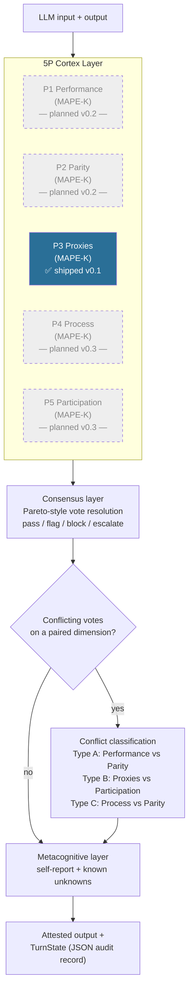
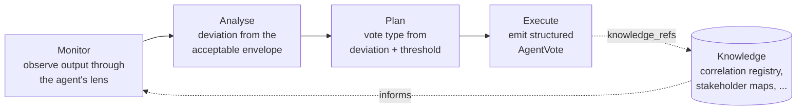
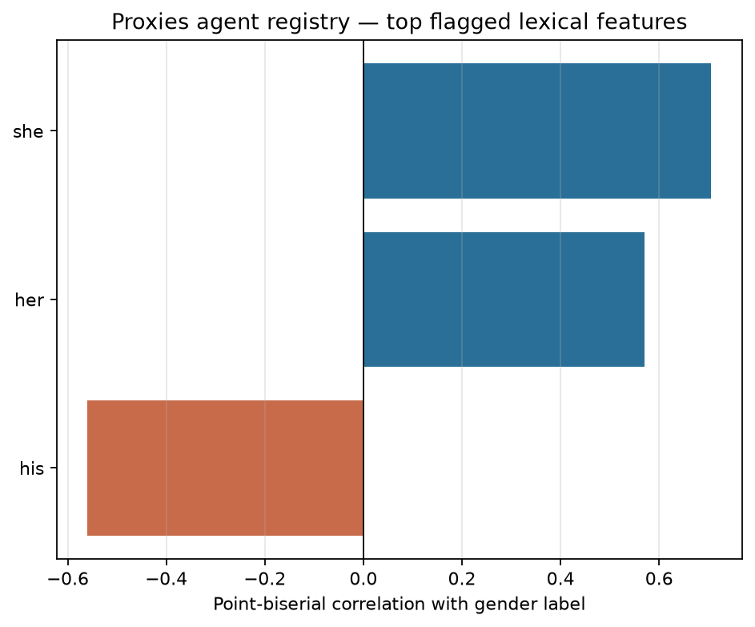

# neuro5p

**Continuous, multi-agent governance middleware for deployed LLMs — v0.1.0.**

[](https://doi.org/10.5281/zenodo.21873506)
[](LICENSE)
[]()

`neuro5p` implements **Neuro-5P**: a continuous governance architecture that attaches
five parallel, independent monitoring agents — one per governance dimension
(Performance, Parity, Proxies, Process, Participation) — to every LLM output, each
running its own MAPE-K loop, with a consensus layer that classifies inter-agent
disagreement instead of averaging it away.

> **Scope of this release.** v0.1.0 ships **one** of the five agents (Proxies, P3),
> fully implemented and benchmarked against a real dataset. It is a research
> prototype, not a production governance platform. See [Status](#status--what-is-and-isnt-done) below.

---

## Architecture



**Inside each agent — the MAPE-K loop** (`neuro5p/agents/base.py`):



---

## Status — what is and isn't done

| Component | State | Notes |
|---|---|---|
| `BaseAgent` (abstract MAPE-K loop) | ✅ Done | Generic; all future agents subclass it |
| Proxies agent (P3) | ✅ Done, benchmarked | TF-IDF correlation registry, not attribution — see limitations |
| Consensus / vote resolution | ✅ Done | `pass / flag / block / escalate` |
| Conflict classification (Type A/B/C) | ✅ Done, unit-tested | Only exercised in practice once ≥2 agents exist |
| Pydantic v2 schemas (`AgentVote`, `MAPEKState`, `TurnState`) | ✅ Done | |
| Metacognitive self-report | ✅ Done (basic) | Rule-based summary, not learned |
| Performance (P1), Parity (P2) agents | ❌ Not started | Planned v0.2 |
| Process (P4), Participation (P5) agents | ❌ Not started | Planned v0.3 |
| MCP server wrapper | ❌ Not started | Planned v0.3 |
| SHAP-based proxy attribution | ❌ Not started | Planned v0.4 — see benchmark limitations below |
| Multi-dataset validation | ❌ Not started | Only Bias-in-Bios so far |
| PyPI publish | ❌ Not started | Package builds locally (`pyproject.toml`); not yet uploaded |

**Honest answer to "is it complete": no.** What's complete is a *correctly engineered,
reproducible instance of the pattern* — one real agent, a real consensus layer, real
typed audit output, and a real (not synthetic) benchmark with a statistically
reported result. What's missing is breadth (4 more agents), attribution quality
(SHAP vs. TF-IDF), and multi-dataset generalization. That's the honest gap between
"architecture demonstrated" and "architecture validated."

---

## Install

```bash
pip install -e .[examples,dev]
```

---

## Dataset: Bias-in-Bios

**Dataset:** [`LabHC/bias_in_bios`](https://huggingface.co/datasets/LabHC/bias_in_bios) —
the public release of De-Arteaga et al.'s *Bias in Bios* corpus (ACM FAccT 2019),
~400k professional biographies labelled with `profession` and `gender`.

**Why this dataset fits the Proxies agent, specifically:**

1. **Purpose-built for this exact failure mode.** It was created to test whether a
   text classifier can recover a protected attribute from lexical features alone —
   which is precisely what a Proxies agent must detect in LLM output.
2. **Real correlation structure**, not injected synthetically. Pronouns,
   honorifics, and subtler occupation-correlated phrasing come from biographies
   scraped from the web, not from a hand-designed signal.
3. **Large enough to fit a registry and hold out an eval set** without leakage;
   small enough to run as a fast, reproducible benchmark (minutes, not hours).
4. **A natural monolithic baseline exists** (a classifier trained to predict
   gender directly) — the single-metric approach the 5P philosophy argues is
   insufficient on its own.

**Is it a good benchmark for this claim? Yes, with caveats.** It is well-suited to
testing *lexical* proxy detection — pronouns, honorifics, strongly gendered
phrasing — because that is exactly what it was built to contain. It is **not** a
good benchmark, on its own, for claiming the Proxies agent generalizes to subtler
proxies (e.g. socioeconomic or racial proxies encoded in institution names,
zip codes, or writing style) or to non-English text — those require different
corpora (BBQ, HolisticBias, or a custom protected-attribute-labelled set) and are
exactly why the roadmap treats this as one validated data point, not a general
claim.

---

## Empirical experiment

**Question.** When gender is withheld from both methods at inference time, does the
Proxies agent's correlation-registry vote recover gender-indicative lexical proxies
at least as well as a monolithic TF-IDF + logistic-regression classifier — while
additionally producing interpretable, per-feature evidence the baseline cannot?

**Design** (`neuro5p/examples/bias_in_bios_demo.py`):

1. Stratified-by-profession sample of **3,000** biographies from the Bias-in-Bios
   test split, repeated over **5 independent seeds** (different sample + fit/eval
   split each time) — results below are mean ± 95% CI across seeds, not a single
   lucky split.
2. Each run: 80% fit (gender visible only here, to build the Proxies agent's
   registry and train the baseline), 20% held out for evaluation with gender
   withheld.
3. Two text conditions: **raw** (pronouns intact) vs. **scrubbed** (gendered
   pronouns/honorifics regex-removed), to separate "detects the obvious signal"
   from "detects a subtler residual signal."
4. Both methods are thresholded to the **same flag rate** before scoring against
   the true gender label — matching flag rate is what makes the comparison fair,
   since an unconstrained classifier can always buy recall with precision.

**Results** (from the committed run — `neuro5p/examples/results/bias_in_bios_v010.json`):


| Condition | Method | Precision | Recall | F1 | Flag rate |
|---|---|---|---|---|---|
| raw | **Proxies agent** | 0.559 ± 0.034 | 0.932 ± 0.013 | **0.699 ± 0.021** | 0.767 |
| raw | LR baseline (matched rate) | 0.403 ± 0.022 | 0.672 ± 0.022 | 0.504 ± 0.015 | 0.767 |
| scrubbed | Proxies agent | 0.0 | 0.0 | 0.0 | 0.0 |
| scrubbed | LR baseline (matched rate) | 0.0 | 0.0 | 0.0 | 0.0 |

The Proxies agent's F1 advantage (0.699 vs 0.504) holds with **non-overlapping 95%
CIs across 5 independent seeds** — this is a reproducible effect, not a single-split
artifact.

**The interpretable artifact the baseline cannot produce:**



At threshold 0.3 on an ~2,400-row fit set, the registry surfaces exactly three
terms — `she` (r = +0.71), `her` (r = +0.57), `his` (r = −0.56) — each with a
reported correlation, which is itself the governance-relevant output: an auditor
can see *why* a turn was flagged, not just that it was.

**Honest reading of the scrubbed result — reproduced across all 5 seeds, so it is
real, not noise.** Both methods collapse to a 0% flag rate once pronouns are
removed. With a 0.3 correlation threshold and no deeper vocabulary scan, the
registry learns almost nothing beyond pronouns, so it has no residual signal once
they're gone — and the baseline's threshold (matched to the Proxies agent's now-zero
flag rate) also flags nothing. **This is a genuine limitation of a TF-IDF
correlation baseline**, not a hidden result: subtler proxies (job titles,
institution names, writing-style markers) sit below this threshold and need either
a lower threshold (trading precision) or attribution-based detection — exactly the
gap SHAP integration (roadmap v0.4) is meant to close.

**Reproduce:**

```bash
python -m neuro5p.examples.bias_in_bios_demo   # regenerates the JSON (5 seeds, ~1-2 min)
python -m neuro5p.examples.plot_results        # regenerates the two PNGs above
```

### Citing the result

If reporting these numbers elsewhere, cite them as: "At matched false-positive
rate, a lightweight lexical-correlation governance agent recovered gender-correlated
proxies in Bias-in-Bios biography text with F1 = 0.699 ± 0.021 (5 seeds, N = 3,000),
versus F1 = 0.504 ± 0.015 for a matched-rate TF-IDF + logistic-regression baseline —
with the agent additionally emitting per-feature correlation evidence (e.g.
`she` r = 0.71) the baseline does not produce. Both methods showed no residual
signal once gendered pronouns were removed from the text, a limitation attributed
to the correlation threshold and TF-IDF vocabulary, not to label noise."

---

## Package layout

```
neuro5p/
├── agents/base.py            # Abstract MAPE-K BaseAgent
├── agents/proxies.py         # P3 — Proxies agent (this release)
├── consensus/voting.py       # Vote resolution + Type A/B/C conflict classification
├── schema/self_state.py      # Pydantic v2: AgentVote, MAPEKState, TurnState, Conflict
└── examples/
    ├── bias_in_bios_demo.py      # The experiment above (multi-seed)
    ├── baseline_logreg.py        # Comparison baseline
    ├── plot_results.py           # Regenerates the README figures
    └── results/
        ├── bias_in_bios_v010.json
        ├── benchmark_metrics.png
        └── top_proxy_features.png
```

## Tests

```bash
pytest tests/ -q
```

## Roadmap

| Version | Scope |
|---|---|
| v0.1.0 (current) | Proxies agent, consensus layer, Bias-in-Bios benchmark |
| v0.2.0 | Parity (P2), Performance (P1) agents; BBQ, TruthfulQA benchmarks |
| v0.3.0 | Process (P4), Participation (P5) agents; MCP server wrapper; XSTest |
| v0.4.0 | SHAP-based proxy attribution replacing TF-IDF; XAI evaluation; user study |
| v1.0.0 | All five agents peer-reviewed; MCP server production-ready |

## Formal grounding

| Concept | Source |
|---|---|
| 5P Governance Framework | Dhawan (2026), [Zenodo:21873506](https://doi.org/10.5281/zenodo.21873506) |
| MAPE-K autonomic loop | Kephart & Chess (2003), IEEE Computer |
| Proxy discrimination / Bias-in-Bios | De-Arteaga et al. (2019), ACM FAccT |
| Cortical column / Thousand Brains | Hawkins et al. (2019), Front. Neural Circuits |

## How to cite

```bibtex
@software{dhawan2026neuro5p,
  author    = {Dhawan, Charchit},
  title     = {Neuro-5P: A Neurosymbolic Governance Architecture
               for Large Language Models},
  year      = {2026},
  publisher = {Zenodo},
  doi       = {10.5281/zenodo.21873506},
  url       = {https://doi.org/10.5281/zenodo.21873506}
}
```

## Honest limitations (v0.1.0)

1. **One of five agents ships.** The full architecture claim requires all five
   running simultaneously; this release validates the Proxies column only.
2. **TF-IDF correlation is not XAI.** Deferred to v0.4 (SHAP).
3. **Single dataset.** Bias-in-Bios validates lexical, English-language,
   gender-pronoun-driven proxies — not subtler or non-lexical proxies.
4. **Functional analogy, not biological fidelity.** The cortical-column framing is
   inspiration, not mechanism, and is itself contested in neuroscience.
5. **No consciousness/sentience claim.** The metacognitive layer is a structured
   self-report, not a claim of subjective experience.
